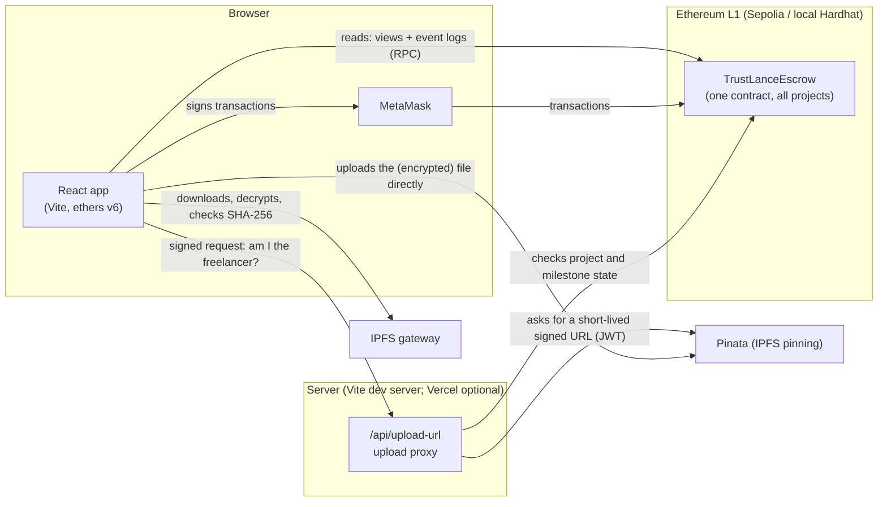
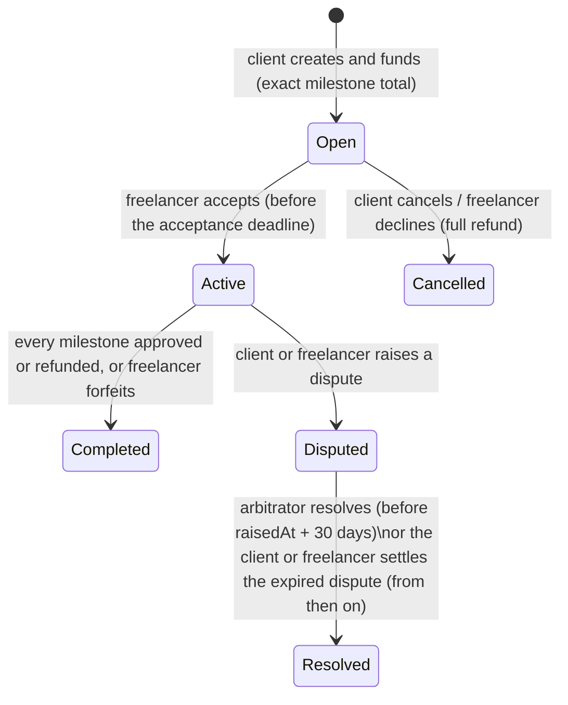

# TrustLance

TrustLance is a decentralized escrow for freelance work on Ethereum. A client funds a whole project up front, split into milestones. The freelancer delivers each milestone as a file on IPFS, optionally encrypted. The client approves the work or asks for changes. Every approval, refund and dispute outcome is decided by one smart contract, with no company in the middle holding the money.

It is a finished university project. It runs on a local Hardhat chain for development and is **deployed and verified on the Sepolia test network**, where a real client and freelancer have completed projects through it. **Use test ETH only, never real funds.**

## Live deployment

| | |
| --- | --- |
| Network | Ethereum Sepolia (chain id `11155111`) |
| Contract | [`0xE387D1Eb6880B2A02EC14b49f90B0e63d1638789`](https://sepolia.etherscan.io/address/0xE387D1Eb6880B2A02EC14b49f90B0e63d1638789#code) |
| Verified source | Etherscan (Exact Match) and Sourcify (exact match) |
| Deployed | 2026-11-07, block 12082738, with Hardhat Ignition |
| Admin / default arbitrator | `0x6B849A42f245319720Bdf8Db67030e6E6695C74e` / `0x5351c2ecB4bD0Fd074441b4cAc400f5F9FD66815`, fee 1% |

**To try it, see [`DEMO.md`](DEMO.md)**: it runs the web app locally against this contract, with no redeployment.

- [Live deployment](#live-deployment)
- [Architecture](#architecture)
- [Roles](#roles)
- [How a project works](#how-a-project-works)
- [Disputes](#disputes)
- [Features](#features)
- [Local setup](#local-setup)
- [Commands and tests](#commands-and-tests)
- [Sepolia deployment](#sepolia-deployment)
- [Environment variables and secrets](#environment-variables-and-secrets)
- [University demo](#university-demo)
- [Trust assumptions and known risks](#trust-assumptions-and-known-risks)
- [Project documents](#project-documents)

## Architecture



There are three deployable parts, in one npm-workspaces repository:

| Part | Folder | Technology | Why |
| --- | --- | --- | --- |
| Smart contract | `contracts/` | Solidity 0.8.34, OpenZeppelin 5, Hardhat 3, Ignition | One non-upgradeable contract holds every project's escrow (ADR 0001). Pull payments: every amount owed is credited to a withdrawable balance, and only `withdraw` sends ETH. Hardhat 3 runs both Solidity (fuzz and invariant) and TypeScript tests; Ignition makes deployments reproducible. |
| Web app | `web/src` | React 19, Vite, TypeScript, Tailwind, ethers v6 | Reads come straight from contract views, and the activity timeline from event logs. There is no indexer, no database and no mocked chain data. MetaMask signs every transaction. |
| Upload proxy | `web/api/upload-url.ts`, `web/server/` | One serverless function, served by the Vite dev server locally (Vercel-ready, not hosted) | The only server code (ADR 0004). It keeps the Pinata key secret and hands out short-lived, size-limited upload URLs, only to the wallet that is the freelancer of an active project with that milestone open. It stores nothing. |

**Ethereum L1 and IPFS.** The contract only stores a deliverable's **manifest CID**, a short IPFS identifier. The file and its manifest (name, type, size, SHA-256, encryption parameters) live on IPFS, pinned by Pinata. Before uploading, the freelancer can encrypt the file in the browser (AES-GCM with a key derived from a passphrase by PBKDF2), then shares the passphrase with the client off-chain. On download, the client's browser decrypts the file and checks it against the SHA-256 the freelancer committed to on-chain. There are no L2s, bridges, tokens, NFTs or upgradeable proxies.

## Roles

| Role | Who | Can |
| --- | --- | --- |
| **Client** | Creates and funds a project | Cancel before acceptance, approve or request revisions (at most 2 per milestone), refund overdue milestones, raise a dispute, settle an expired dispute, withdraw |
| **Freelancer** | Named by the client | Accept or decline, submit deliverables, record auto-approval, forfeit the rest of a project, raise a dispute, settle an expired dispute, withdraw |
| **Arbitrator** | The platform's default arbitrator, fixed on each project when it is created | Resolve that project's dispute within 30 days, for a fee (1% by default, at most 10%), then withdraw the fee |
| **Admin** | The deployer's chosen admin account | Change the default arbitrator and fee **for future projects**, and pause or unpause **project creation only**. Can hand the role to another account (two-step transfer) or renounce it. No power over escrowed funds |

Use different accounts for the admin and the arbitrator; `npm run check:sepolia` checks this. The contract refuses projects created by the default arbitrator. Definitions of every term are in [`CONTEXT.md`](CONTEXT.md).

## How a project works



Each milestone moves through these states:

1. **Pending.** Its delivery period starts when the project is accepted. The freelancer uploads the deliverable and submits its manifest CID, which makes it **Submitted**.
2. **Submitted.** The client's review window (1–30 days, chosen per project) starts. The client can:
   - **approve**, which credits the amount to the freelancer's withdrawable balance;
   - **request a revision** with a public note, which sends it back to Pending (at most 2 per milestone);
   - **do nothing**: from the review deadline the milestone counts as approved, and anyone can record that auto-approval.
3. **Overdue.** If a Pending milestone passes its delivery deadline, the client can **refund** it. The freelancer can still submit late until then; whichever transaction is mined first wins.
4. **Forfeit.** The freelancer can **forfeit** the rest of the project. Everything already earned stays theirs, and the rest goes back to the client.
5. **Withdraw.** Money never moves by itself: every outcome credits a withdrawable balance, and each account withdraws its own balance with **Withdraw all**.

Deadlines are half-open, to the second. A window action needs `now < D`, and an expiry action needs `now ≥ D`. Approved milestones and withdrawable balances are final: no refund, dispute or forfeit can touch them.

## Disputes

- **Raising.** Either party can raise a dispute on an Active project, with a public reason. Submissions whose review window has already ended are credited to the freelancer first. Every other open milestone is **frozen**.
- **Arbitrator resolution.** Within 30 days, the project's arbitrator chooses how much of the frozen funds the freelancer gets. The arbitration fee (the project's rate, rounded down) is taken first, and the client gets the rest. The UI previews the exact amounts in wei, and the end-to-end suite checks that the preview equals what the contract credits.
- **Expired-dispute settlement.** From `raisedAt + 30 days` on, either party can settle with a fixed fallback split and no fee:
  - frozen Pending milestones go back to the client;
  - frozen submissions are split in half, with the odd wei to the client.

A dispute pays out exactly once.

## Features

- **Projects.** Create and fund a project with up to 20 milestones, each with a title, an amount and a delivery period. A form validates everything the contract checks.
- **Offers.** The freelancer accepts or declines; the client can cancel before acceptance.
- **Deliverables.** Encrypted or public uploads through the proxy to Pinata, plus download, decryption and SHA-256 verification in the browser.
- **Review.** Approve, request revisions (with the number left shown), record auto-approval, refund overdue milestones and forfeit.
- **Disputes.** Raise a dispute with the frozen amounts previewed. The arbitrator console lists the disputes to resolve, with a split slider and an exact-wei input. Either party can settle an expired dispute.
- **Balances.** A withdrawable-balance page with a single withdrawal.
- **Dashboard.** Lists offers, work and created projects for the connected account.
- **Activity timeline.** Every on-chain event of a project, read from event logs with paging. Each entry shows the actor's role, a time, an "unconfirmed" badge until 5 confirmations on Sepolia, and an Etherscan link.
- **Network handling.** MetaMask connect, a network-switch prompt (it adds Sepolia if missing), and a read-only view on unsupported networks.

## Local setup

Requirements: **Node.js ≥ 22.13** and Git. Running the end-to-end suite also needs Google Chrome; the [E2E docs](docs/e2e.md) explain how to use Playwright's Chromium instead. You need MetaMask only for manual testing in a browser.

```bash
git clone https://github.com/mahmoudfourati/trustlance.git
cd trustlance
npm install
npm run compile
```

Run the app against a local chain, in three terminals:

```bash
npm run chain          # 1. Hardhat node at http://127.0.0.1:8545 (chain id 31337)
npm run deploy:local   # 2. deploy with Ignition, export ABI + address to the web app
npm run dev            # 3. web app at http://localhost:5173
```

To use MetaMask locally:

1. Add the network: RPC `http://127.0.0.1:8545`, chain id `31337`, currency ETH.
2. Import one of the accounts that `npm run chain` prints. These are **public test keys; never send real funds to them.**
   - Account #0 is the admin.
   - Account #1 is the arbitrator.
   - Use #2 and #3 as client and freelancer.

Without MetaMask, `npm run dev -w @trustlance/web -- --mode testwallet` starts a dev-only test wallet that signs with the node's accounts. `?testAccount=N` picks the account (default 2).

Deliverable uploads need a Pinata JWT: copy `web/.env.example` to `web/.env.local` and set `PINATA_JWT` (see [upload proxy](docs/upload-proxy.md)).

## Commands and tests

| Command (repo root) | What it does |
| --- | --- |
| `npm run compile` | Compile the contract (`hardhat build`) |
| `npm test` | Contract tests (Solidity unit/fuzz/invariant/adversarial + TypeScript), then web unit tests (vitest) |
| `npm run test:coverage` | Contract tests with Solidity coverage |
| `npm run test:deep -w @trustlance/contracts` | Long fuzz and invariant campaign (about 18 min) |
| `npm run typecheck` / `npm run lint` | TypeScript in every part / oxlint on the web app |
| `npm run build` | Production web build |
| `npm run check` | All of the above in order (not `test:deep`, not E2E) |
| `npm run test:e2e` | Playwright end-to-end suite: fresh node, deploy, local IPFS stand-in, real browser |
| `npm run test:e2e:pinata` | Opt-in browser test against real Pinata (needs `PINATA_JWT`; skipped otherwise) |
| `npm run smoke:upload -w @trustlance/web` | Node smoke test of the upload proxy against real Pinata |
| `npm run deploy:sepolia` / `npm run check:sepolia` | Deploy to Sepolia and verify on Etherscan / read-only check of the deployment |

**Results** (2026-10-28; `npm run check` and `npm run test:e2e` re-run on 2026-11-07 with the same counts):

| Suite | Result |
| --- | --- |
| Contract tests | 196 passing: 24 Solidity and 172 mocha. 100% line and statement coverage of `TrustLanceEscrow.sol`. |
| Fuzz and invariants | The 13 spec invariants pass under the default and deep profiles; the deep campaign made about 2 million handler calls. |
| Mutation check | 16/16 injected bugs detected. |
| Web unit tests | 148 passing. |
| End-to-end | 12 scenarios passing, repeatedly, with exact-wei and D − 1 / D boundary checks on-chain. |
| Real Pinata | The browser upload, on-chain submit, gateway read, decryption and hash check passed. |

Details: [docs/security.md](docs/security.md), [docs/e2e.md](docs/e2e.md), [docs/upload-proxy.md](docs/upload-proxy.md).

## Sepolia deployment

The contract is already deployed (see [Live deployment](#live-deployment)); **don't redeploy it** to run the demo. The deployment is reproducible from the committed record:

- `contracts/ignition/deployments/chain-11155111/`: Ignition's journal, the deployed artifact and the build info (public data only: addresses, transaction hashes, bytecode);
- `contracts/ignition/parameters/sepolia.json`: the admin, arbitrator and fee used (public addresses);
- `web/src/contracts/generated/deployments.ts`: the address per chain the web app uses (`31337` for local, `11155111` for Sepolia).

Check it at any time, read-only and without secrets:

```bash
npm run check:sepolia    # chain id, bytecode, receipt, deployment block, roles, fee, pause state, exported address
```

How it was deployed (keystore secrets, parameters, `npm run deploy:sepolia` with Etherscan verification, the chain-id lock, troubleshooting) and the transaction hashes of the demo run are in **[docs/deployment.md](docs/deployment.md)**. Hosting on Vercel is described there as an **optional** extra; it has not been set up.

## Environment variables and secrets

| Variable | Where | Secret? | Purpose |
| --- | --- | --- | --- |
| `SEPOLIA_RPC_URL` | Hardhat keystore | Yes (may contain an API key) | RPC the deployer uses |
| `SEPOLIA_PRIVATE_KEY` | Hardhat keystore | **Yes** | Deployer account (test ETH only) |
| `ETHERSCAN_API_KEY` | Hardhat keystore | Yes | Source verification |
| `PINATA_JWT` | `web/.env.local` / host (server) | **Yes** | Upload proxy's Pinata key (`org:files:write`) |
| `UPLOAD_PROXY_RPC_URL_11155111` | `web/.env.local` / host (server) | Maybe | RPC the proxy uses to check the freelancer |
| `VITE_DEFAULT_CHAIN_ID` | `.env.local` (or a host) | No | `11155111` to browse Sepolia without a wallet |
| `VITE_SEPOLIA_RPC_URL` | `.env.local` (or a host) | **No: bundled into the page** | Read RPC with full log history |
| `VITE_PINATA_GATEWAY` | `.env.local` (or a host) | No | Dedicated gateway host for downloads |

Rules:

- **Never commit a secret.** Only `*.example` files are tracked; `.env*`, keystores and test outputs are gitignored. Full-history searches on 2026-10-28 and 2026-11-07 found no secret.
- **Never prefix a secret with `VITE_`.** Vite bundles every `VITE_` variable into public JavaScript.
- **Keep the deployer and every demo account to test ETH only.**

## University demo

**[`DEMO.md`](DEMO.md)** is the guide for running the app against the deployed contract. On 2026-11-07 the deployment was exercised on Sepolia by separate accounts (hashes in [docs/deployment.md § 8](docs/deployment.md#8-recorded-sepolia-deployment-and-demo-run)):

| Account | Role | Address |
| --- | --- | --- |
| Admin (deployer) | Admin | `0x6B849A42f245319720Bdf8Db67030e6E6695C74e` |
| Arbitrator | Default arbitrator | `0x5351c2ecB4bD0Fd074441b4cAc400f5F9FD66815` |
| Client | Client | `0xA9f2e4b557C76fcb71Ff9C4cA75746081728ac0E` |
| Freelancer | Freelancer | `0x4033Fb6190463cc60FC91Dd1BD3fBb7778633c4E` |

- **Project 1, "TrustLance Sepolia Demo":** 2 milestones of 0.001 ETH. Created and funded, accepted, both deliverables submitted to IPFS and approved, project Completed, then 0.002 ETH withdrawn by the freelancer.
- **Project 2, "Demo Project":** 1 milestone of 0.001 ETH, same flow, 0.001 ETH withdrawn.

Disputes, revisions, refunds, forfeit and expired settlement were not run on Sepolia. They are covered on the local chain by the contract tests and the Playwright suite, which can move time; expired settlement needs 30 days on a real network.

## Trust assumptions and known risks

From [docs/security.md](docs/security.md) and the ADRs:

- **Arbitrator trust.** The arbitrator decides the split of frozen funds, can favour or collude with one party, and can delay a disputed project by up to 30 days. It can't touch approved funds, earlier refunds, other projects or anything beyond the fixed fee.
- **Admin.** The admin can pause new projects indefinitely, transfer the role (two-step) or renounce it. Existing projects, disputes and withdrawals keep working.
- **Late submission vs overdue refund.** From the delivery deadline, both are valid and the first one mined wins.
- **Timestamps.** Block producers can shift `block.timestamp` by a few seconds; the windows are hours to days. The UI shows deadlines from the browser clock, while the contract decides by block time.
- **Forced ETH** (via `selfdestruct`) stays locked in the contract, and a party that can't receive ETH only locks its own balance.
- **Fee overflow** happens only above about 10⁷⁴ wei frozen, an impossible amount; expired settlement still works then.
- **IPFS.**
  - A CID guarantees integrity, not availability: pins must be kept for the demo.
  - The manifest is public even for encrypted files (name, type, size, plaintext hash), so give confidential files neutral names.
  - Public gateways rate-limit; set `VITE_PINATA_GATEWAY`.
- **Upload proxy.** Its rate limit is in memory per serverless instance, and a signed authorization can be reused for up to 5 minutes. The proxy also knows the local chain (31337, `127.0.0.1:8545`); on a host where nothing listens there, such requests fail closed.
- **Large accounts.** The dashboard's view arrays grow with every project that names an account.
- **Not audited.** Fuzzing and invariants found no counterexample, but they are not a formal proof, and no professional audit has been done.

## Project documents

| Document | Content |
| --- | --- |
| [`CONTEXT.md`](CONTEXT.md) | Domain vocabulary |
| [`docs/adr/`](docs/adr/) | Architecture decisions (single escrow contract, disputes, auto-approval, IPFS proxy) |
| [`docs/security.md`](docs/security.md) | Contract test evidence and residual risks |
| [`docs/upload-proxy.md`](docs/upload-proxy.md) | Upload proxy and deliverables |
| [`docs/e2e.md`](docs/e2e.md) | End-to-end suite |
| [`DEMO.md`](DEMO.md) | Run the frontend locally against the deployed Sepolia contract |
| [`docs/deployment.md`](docs/deployment.md) | Sepolia deployment record, how it was deployed, optional hosting, demo checklist |
| [`docs/spec.md`](docs/spec.md) | Full spec: state machines, invariants, acceptance criteria |
| [`docs/tickets/`](docs/tickets/) | The 13 implementation tickets with their verification notes |
